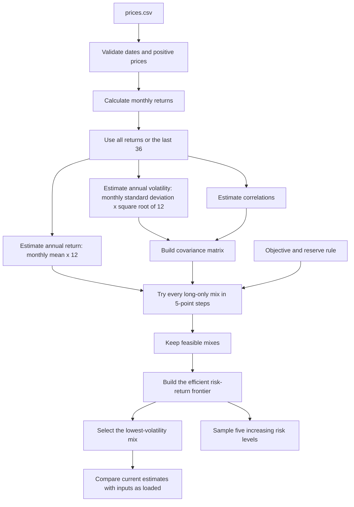

# Lab 15 — Portfolio Stability Decision

## Decision question

Which mix carries the least risk while meeting the mandate, and does the answer survive a
one-point change in one estimate?

The app starts with the Meridian training controls: a 6.5% expected-return objective and a 3%
reserve-eligible minimum. These are classroom defaults until the student's Project 2 mandate
supplies its own numeric objective and hard constraint.

## Run commands

From the FIN 439 folder:

```bash
"Project 1/.venv/bin/python" "Post Project 1/Lab15/portfolio.py"
"Project 1/.venv/bin/streamlit" run "Post Project 1/Lab15/app.py"
```

## Fund universe

| Ticker | Fund | Role | Reserve eligible in the app | Price source |
|---|---|---|---|---|
| TLT | iShares 20+ Year Treasury Bond ETF | Long-duration government bonds | Yes | [Yahoo Finance](https://finance.yahoo.com/quote/TLT/history/) |
| SOXX | iShares Semiconductor ETF | Concentrated semiconductor equity | No | [Yahoo Finance](https://finance.yahoo.com/quote/SOXX/history/) |
| VTI | Vanguard Total Stock Market ETF | U.S. equity | No | [Yahoo Finance](https://finance.yahoo.com/quote/VTI/history/) |
| VXUS | Vanguard Total International Stock ETF | International equity | No | [Yahoo Finance](https://finance.yahoo.com/quote/VXUS/history/) |
| FREL | Fidelity MSCI Real Estate Index ETF | U.S. real estate / REIT sleeve | No | [Yahoo Finance](https://finance.yahoo.com/quote/FREL/history/) |
| GBTC | Grayscale Bitcoin Trust ETF | Spot-Bitcoin alternative | No | [Yahoo Finance](https://finance.yahoo.com/quote/GBTC/history/) |

TLT replaces the cash-like BIL position with materially more interest-rate and duration risk while
keeping one bond-market fund. SOXX replaces IEF with a concentrated semiconductor sleeve and avoids
ARK funds. FREL still makes the real-estate sleeve both a REIT fund and a Fidelity fund. GBTC is
solely and passively invested in Bitcoin, but its five-year history crosses a structural change: it
uplisted from an earlier publicly traded trust to a spot-Bitcoin exchange-traded product in 2024.
SOXX, FREL, and GBTC are analytical sleeves, not reserve assets.

## Price data and sources

- File: `prices.csv`.
- Measure: monthly adjusted close, which incorporates distributions and splits reported by the
  source.
- Common window: Oct. 1, 2021 through Sep. 1, 2026, 60 monthly price observations for every fund.
- Order: oldest month first; date first; one column per ticker.
- Download date: Oct. 22, 2026.
- Price source for every ticker: Yahoo Finance chart data, monthly interval, adjusted close.
- Fund-role verification for the changed funds: [iShares TLT](https://www.ishares.com/us/products/239454/ishares-20-year-treasury-bond-etf),
  [iShares SOXX](https://www.ishares.com/us/products/239705/ishares-phlx-semiconductor-etf),
  and [Grayscale GBTC](https://etfs.grayscale.com/gbtc) issuer materials. VTI, VXUS, and FREL retain
  their previously documented Vanguard and Fidelity roles.

The five-year averages are historical estimates, not forecasts.

## Engine flow



## Meridian validation

| Run | Bills / 10-year / IG / equity | Return | Volatility |
|---|---:|---:|---:|
| As loaded | 0 / 20 / 25 / 55 | 6.51% | 9.44% |
| Equity return 8.0% to 7.0% | 0 / 10 / 10 / 80 | 6.53% | 12.94% |

Largest weight change: 25 percentage points.

The engine also reproduces the Lab 14 benchmark, equal-weight, and inverse-volatility results.
Changing the IG-equity correlation from 0.25 to 0.50 produces the Session 15 correlation-check
allocation, and restoring it returns the original result.

## Own-universe results

The runnable output below uses the provisional 6.5% objective, a 3% reserve minimum, and marks only
TLT as reserve eligible. That classification is a classroom assumption for the government-bond
sleeve; TLT is a volatile long-duration asset, not a cash reserve. The student should replace those
controls if the Project 2 mandate requires different values.

| Estimate window | TLT | SOXX | VTI | VXUS | FREL | GBTC | Return | Volatility | Reserve |
|---|---:|---:|---:|---:|---:|---:|---:|---:|---:|
| All available monthly returns | 20% | 0% | 35% | 45% | 0% | 0% | 6.89% | 13.94% | 20% |
| Last 36 monthly returns | 30% | 0% | 30% | 40% | 0% | 0% | 14.23% | 11.07% | 30% |

### Five-level risk ladder

The app also returns five efficient portfolios using the currently selected estimates. Each level
meets the same return objective and reserve minimum; higher levels trade more estimated volatility
for more estimated return. With the full-history estimates and classroom controls, the ladder is:

| Risk level | TLT | SOXX | VTI | VXUS | FREL | GBTC | Return | Volatility | Reserve |
|---|---:|---:|---:|---:|---:|---:|---:|---:|---:|
| 1 — Lowest feasible risk | 20% | 0% | 35% | 45% | 0% | 0% | 6.89% | 13.94% | 20% |
| 2 — Lower-middle risk | 5% | 15% | 70% | 10% | 0% | 0% | 14.03% | 17.52% | 5% |
| 3 — Middle risk | 5% | 35% | 25% | 30% | 0% | 5% | 18.73% | 21.76% | 5% |
| 4 — Higher risk | 5% | 55% | 5% | 25% | 0% | 10% | 23.99% | 27.14% | 5% |
| 5 — Highest-return efficient | 5% | 95% | 0% | 0% | 0% | 0% | 31.78% | 36.51% | 5% |

These are model outputs, not investor-suitability labels or investment recommendations. Selecting
the last-36-month toggle, editing a return estimate, or changing reserve eligibility rebuilds all
five levels.

The largest allocation change is 10 percentage points in TLT. SOXX, FREL, and GBTC remain in the
tested universe but receive zero weight in both lowest-volatility solutions. The search is doing
what the mandate asks: it does not force a positive holding merely because an asset was included.

Draft call for student review: **pilot, not adopt**. The full-window and 36-return estimates move
10 percentage points into TLT, and the current objective and reserve threshold are still
classroom defaults rather than confirmed Project 2 mandate values. Adoption would require the
student's numeric mandate controls and a partner stress that does not materially overturn the
allocation.

## Partner attack and final call

Complete these two human-review items before submission:

1. Have the partner change the expected-return estimate they distrust most. Record the changed
   allocation and answer the result in two sentences.
2. Choose adopt, pilot, or reject in the student's own words. State the numerical result that
   supports the choice and the condition that would change it.

The app is a learning demonstration built with AI help. It is not investment advice.


###This report was written for FIN 43900 (AI Finance Applications, Purdue) as a learning exercise. It is not investment research and it is not financial advice.

###AI assistance: drafted with [Codex], resumed from my Lab 03 session; sources gathered and verified by me; the judgments are mine.

###Any remaining errors are my own.
