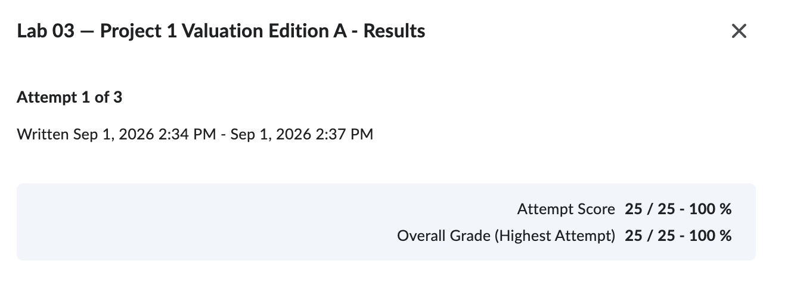

# Research Evolution

**Cadence Design Systems (NASDAQ: CDNS)**

**Valuation Date:** September 1, 2026

**Status:** Edition A is preserved from the Brightspace text-entry checkpoint and my original response. Brightspace did not provide a PDF-upload option. The supervised attempt is recorded as observed pre-AI evidence.

## Brightspace checkpoint evidence

- Brightspace object: **Lab 03 - Project 1 Valuation Edition A - Results**
- Receipt or attempt identifier: **Attempt 1 of 3**
- Attempt window: **September 1, 2026, 2:34 PM-2:37 PM EDT**
- Completion timestamp: **September 1, 2026, 2:37 PM EDT**
- Result: **25/25 - 100%**
- Submission format: **Brightspace text entry; no PDF upload was available**

## Edition A - preserved Brightspace text-entry baseline

The wording below is preserved from the original Lab 03 response supplied by the student on October 17, 2026. No spelling, grammar, or analytical revisions have been made inside Edition A.

### Project 1 Edition A

#### Decision and intended user

Based on Cadence Design Systems' (CDS in text) valuation, we, being junior financial analyst's, will discover whether Cadence is a good investment, or not.

#### Company and valuation date

- Company: Cadence Design Systems
- Ticker: CDNS
- Valuation Date: 09-01-2026
- Intended output unit: $

#### Initial thesis

Initiate valuation procedures and Cadence is likely to pass my screens. Cadence was selected as the valuation target; it was not selected because it passed a valuation screen as we did not complete this in Week 1.

#### Known evidence and sources

- Entity: Cadence Design Systems, Inc.
- Filing/form and accession number: Form 10-K
- Reporting period: FY ended 12-31-2025
- Filing date: 02-19-2026
- Currency and units: US dollars, financial statements in thousands.
- Diluted share evidence: Weighted-average common shares used to calculate diluted net income per share were 273,312 thousand. Diluted net income per share was $4.06. Source: Note 13, Net Income Per Share, and Consolidated Income Statements.
- Cash: Cash and cash equivalents were $3,001.317 million. Source: Consolidated Balance Sheets
- Debt: Long-term debt had a carrying value of $2,480.150 million. Source: Consolidated Balance Sheets and Note 5, Debt.
- Operating-value driver: Total revenue was $5,296.759 million, consisting of $4,821.589 million of product and maintenance revenue and $475.170 million of services revenue. Source: Consolidated Income Statements.

#### Consequential assumptions

The assumptions most capable of changing the decision below:

- CDS's business model is not imitable.

#### Unknowns

I do not have inside information that could help predict future performance of CDS.

#### Research plan

I want to go more in-depth and assess CDS's FCF, EPS, and a wide swath of metrics to see if the valuation passes.

#### Partner falsification question

Is CDS's business model sustainable if the AI bubble were to pop?

## Dated correction addendum

**October 17, 2026:** "CDS" in Edition A referred to Cadence Design Systems. The company's ticker is **CDNS**. Edition B also clarifies that the intended output is **U.S. dollars per diluted share**, rather than dollars generally. Source: the ticker field in Edition A, the cover page of Cadence's FY2025 Form 10-K, and the final model's per-share convention. These corrections clarify the company identifier and unit; they do not change the original thesis or any valuation result.

### I, Luke Meyer, can attest that Edition A was completed without the help of AI.

## Edition B - after project-specific research and disclosed AI assistance

### Current decision and intended user

My recommendation is **watch/defer** for a buy-side investment committee that does not currently own CDNS. I would not initiate a position at the September 1, 2026 market price of **$313.04**.

The integrated FCFF DCF produced a range of **$57.20 to $111.52 per share**, with a base value of **$83.34** after replacing the unsupported 9% WACC with a sourced 10% estimate. Synopsys evidence implied **$209.47 per share** from P/E and **$189.64 per share** from EV/TTM revenue. Both cross-checks remain below the market price.

### What the research now says

- **Strong business, unsupported price:** CDNS has durable operating qualities, but neither the DCF nor the current P/E cross-check supports the market price.
- **Operationally resilient:** Recurring revenue was 80% of FY2025 revenue, which should soften short-run demand shocks.
- **Valuation-fragile:** 74.1% of base enterprise value comes from terminal value. Increasing WACC from 10% to 11% lowered value per share from $83.34 to $72.90, or 12.5%, without changing the operating forecast.
- **Economically exposed:** Cadence's demand still depends on customer chip-design activity and R&D spending. Its own R&D expense was 33% of FY2025 revenue, so costs may not fall as quickly as revenue in a downturn.
- **Market expectations are demanding:** The expanded reverse DCF requires a uniform revenue-growth increase of 32.215 percentage points per year or a 4.871% WACC to reach $313.04. Even the bounded operating challenge reaches only $203.95. CDNS also traded at 14.95x EV/TTM revenue, a 63.8% premium to the 9.12x Synopsys reference.
- **The cycle is now modeled jointly:** An extended AI buildout raises growth and margins but also beta and WACC, producing $93.48 per share. Orderly normalization produces $83.20, while a cycle reversal produces $54.69 and a do-not-initiate action.
- **Acquisition economics are explicit:** A separate Hexagon D&E overlay preserves the base model's historical boundary. Its default assumptions imply $1.095 billion of acquired-operation enterprise value and a combined illustration of $78.93 per share versus the $3.101 billion transaction consideration.

### A-to-B evidence table

| Item | Edition A | Edition B | Primary driver of change | Evidence or test justifying changed or unchanged position |
|---|---|---|---|---|
| Thesis/recommendation | "Initiate valuation procedures" because Cadence was likely to pass the screens. | **Watch/defer; do not buy at $313.04.** | **Mixed:** own analysis, course instruction, and AI-assisted model development. | DCF range of $57.20-$111.52; base value of $83.34; P/E reference of $209.47; EV/revenue reference of $189.64; reverse DCF requires +32.215 percentage points of annual revenue growth. |
| Data/source choice | FY2025 10-K evidence for shares, cash, debt, revenue, and EPS. | FY2025 10-K inputs plus the September 1 market price, operating evidence, frozen output, and validation results. | **Mixed:** own analysis and course instruction. | Base-year reconciliation passed; market price is dated to the valuation boundary; material inputs and limitations are disclosed. |
| Assumption/model design | "CDS's business model is not imitable" and a plan to review FCF, EPS, and other metrics. | Five-year three-statement pro-forma linked to FCFF DCF, calculated decision rules, market-implied expectations, correlated industry regimes, acquisition overlay, sensitivity, and enterprise-to-equity bridge. | **Mixed:** course instruction, own analysis, peer challenge, and disclosed AI assistance. | Statements tie; DCF direction, scenario ordering, decision thresholds, market-price reconciliation, regime ordering, acquisition monotonicity, bridge, and fail-loud tests pass. |
| Risk/limitation/uncertainty | No inside information; partner asked whether the business model would remain sustainable if the AI bubble popped. | CDNS may be operationally resilient but valuation-fragile. Hexagon is tested in a separate overlay rather than a full statement rebuild, and Synopsys remains one qualified peer. | **Mixed:** own economic interpretation, peer challenge, and disclosed AI assistance. | 74.1% terminal-value share; +32.215 growth points or 4.871% WACC to reach price; bounded case $203.95; cycle-reversal value $54.69; default Hexagon overlay $78.93 combined. |

### What changed from Edition A to Edition B, and why?

My view changed from an initial **initiate** research thesis to **watch/defer**. The company still looks operationally strong, but the valuation work did not support the September 1 market price. The biggest change was moving from a filing-based research plan to an integrated decision system with a defendable range, calculated committee rules, market-implied tests, correlated cycle regimes, a separate acquisition overlay, and visible accounting checks.

The economics changed how I describe the risk, not the valuation method. CDNS has recurring revenue and sustained customer R&D demand, but most of the DCF value sits far in the future. The new industry regimes show that a boom can raise cash flows and beta at the same time, while the acquisition overlay shows that strategic fit does not automatically establish value creation. I would reconsider only if rebuilt acquisition-aware cash flows and stronger peer evidence support a value range near the market price with a margin of safety.

### Remaining analytical boundary before final submission

- Preserve the boundary between the FY2025-based DCF, the separate Hexagon overlay, and the acquisition-aware 2026 peer bridge; do not silently mix the three sets of facts and assumptions.

### Evidence locations

- `outputs/visible-output.txt`
- `outputs/validation-evidence.txt`
- `docs/validation-and-ai-use.md`
- `docs/wacc-and-ev.md` (internal evidence worksheet; not a Brightspace deliverable)
- `project1_model.py`
- `tests/test_model.py`
- Cadence FY2025 Form 10-K: https://www.sec.gov/Archives/edgar/data/813672/000081367226000016/cdns-20251231.htm
- September 1, 2026 market-price history: https://chartexchange.com/symbol/nasdaq-cdns/historical/

---

This report was prepared for FIN 43900 (AI Finance Applications, Purdue) as a learning exercise. It is not investment research or financial advice. Material AI assistance and its independent checks are disclosed in `docs/validation-and-ai-use.md`. The judgment remains mine.
